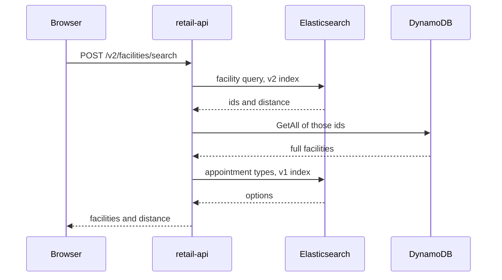
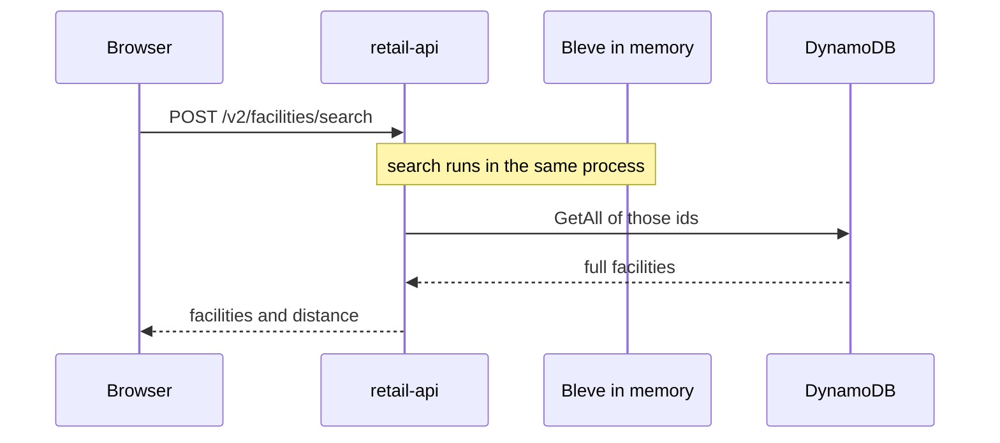

# bleve-facilities-poc

**TLDR:** Bleve should not replace Elasticsearch: the 25-mile search takes about 4 ms in both engines, and the 272 ms Swagger time is the trip to stage.

Local proof for [RB-285](https://warbyparker.atlassian.net/browse/RB-285): try replacing geolocation in facility search, v1 and v2, with Bleve. Facilities cover stores, labs, and third-party suppliers. Search runs on Elasticsearch today. A query change already reduced the slowness, and the remaining goal is a near-instant response. Bleve would run inside the API containers. The current queries stay as they are. The comparison point is the Swagger search for `Greene`, which takes 272 ms. Deploy only if the improvement over that time is large.

Two searches were compared. `Greene` is a word search. The other is facilities within 25 miles of latitude 40.726 and longitude -73.996. Elasticsearch was timed on the stage index `facilities_v2_20250416_154800`, which has 553 facilities. Bleve was timed on an export of those same facilities. The retail API was not changed.

## Elasticsearch

Elasticsearch is a separate service. The API sends it the query over the network and gets back ids. Geolocation is a filter and a sort inside that same `POST /v2/facilities/search` query, so replacing it means replacing that part of the query. The API then loads each facility from DynamoDB and makes a second call to the old v1 index for appointment-type options.



The number Elasticsearch reports as `took` is only the time inside the cluster, after the query arrives. On stage that was 4 ms for `Greene` and 4 ms for the distance search. Read `took` in Kibana Dev Tools, not in Postman. Postman against stage measures the full trip and also needs a Cloudflare Access session. The API, including that call, DynamoDB, and the second search, responded in 34 ms. Swagger showed 272 ms because that includes the trip from the laptop to stage.

## Bleve

Bleve is a library. "Local" means the index lives in the memory of the API process, so the API does not call another service to get the ids. The browser still calls the API in AWS, and DynamoDB still loads each facility. Those two steps stay either way.



This program is only the Bleve lookup. It loads the facilities and returns ids. It does not call DynamoDB and it does not build the API response.

## Results

| | Greene | 25 mi around 40.726, -73.996 |
|---|---|---|
| Elasticsearch | 4 ms | 4 ms |
| Bleve | 0.28 ms | 3.863 ms |

On the word search, Bleve is faster. On the distance search, both engines take about 4 ms and return RBPK first. Bleve places that facility about 0.16 miles away.

The word queries were not identical: the Elasticsearch timing searched name fields, and Bleve also matches the street, so it returns an extra facility. The distance query used the same point, radius, and filters. The Kibana timing did not include the appointment-type aggregation the API always sends, and production and a load test were not measured. On this 553-facility index those still sit in milliseconds. The old v1 index was not timed on its own. The `distance` field on the API response is the Elasticsearch score; the miles above come from Bleve. The stage export used for the Bleve run stays on the machine that ran it and is not in this repository. The Elasticsearch queries in retail-services were not modified.

```bash
go test .
go run .
go run . -serve -data testdata/facilities-stage.json
```

`-serve` listens on `127.0.0.1:8787`. The Postman collection in `postman/` has only the local Bleve requests. In a Bleve response, `tookMs` is the search time. Stage search time is the `took` field in Kibana Dev Tools.

## Conclusion

The distance search is the one this proof was meant to speed up. It takes 4 ms in Elasticsearch and 3.863 ms in Bleve, and both return RBPK first. That gap is not large enough to deploy.

The word search is faster in Bleve, 0.28 ms against 4 ms. Elasticsearch was timed on name fields only. Bleve also matches the street.

Running the index inside the API process removes the call from the API to Elasticsearch. The API already answers in 34 ms with that call, the DynamoDB load, and the appointment-type lookup included. Swagger's 272 ms is the laptop reaching stage. Replacing the engine leaves that trip as it is, and it leaves the DynamoDB load as it is. The current Elasticsearch queries stay in retail-services.
