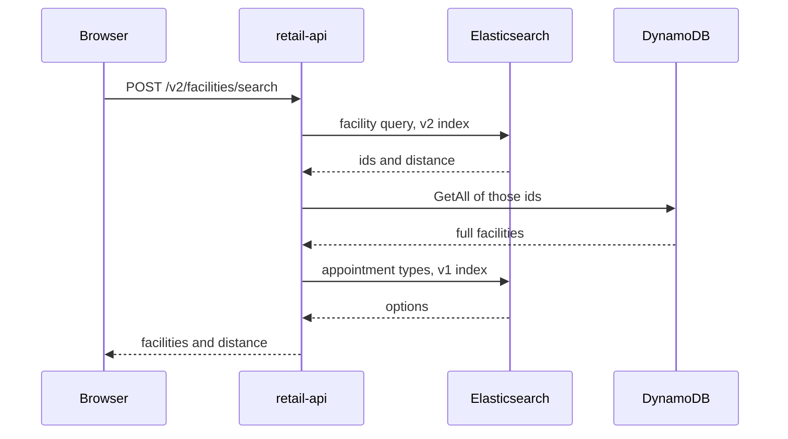
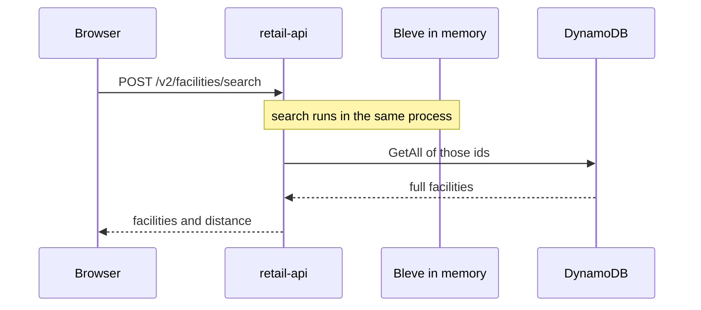

# RB-285 findings

Do not replace Elasticsearch with Bleve. The search engine is already fast. The time people notice is the trip to the API, and Bleve does not remove that trip.

## What was asked

[RB-285](https://warbyparker.atlassian.net/browse/RB-285) has only a title: "POC: Replace geolocation of facility search in v1 and v2 with Blevesearch". It has no description and no comments.

The kickoff notes ask for a local proof, without changing the current queries. Bleve would run inside the API containers. The example of the current speed is Swagger: search `Greene` and get a response in 272 ms. Deploy only if that comparison shows a large improvement.

## Where the time goes

A search request does more than look up ids.



Measured on stage, index `facilities_v2_20250416_154800`, 553 facilities:

| Slice | Greene | Near 40.726, -73.996, 25 mi |
|---|---|---|
| Swagger or browser, full trip | 272 ms in the notes, about 190 ms on a later call | about 190 ms |
| API, `x-envoy-upstream-service-time` | 34 ms | 34 ms |
| Elasticsearch `took` | 8 ms, 2 hits | 1 ms, 27 hits |

`took` is the time inside Elasticsearch after the query arrives. It does not include the network hop from the API to the cluster. The 272 ms and the 34 ms include that hop. The pieces are nested. They are not four numbers that add up to 272.

## What Bleve changes

Bleve is a library. The index lives in the memory of the API process, so the first arrow from the API to Elasticsearch goes away. The browser still calls the API. DynamoDB still loads the full facility.



"Local" means that in-process search. It does not mean the browser talks to the laptop, and it does not mean the stage trip disappears.

This program is only the Bleve box. It loads the 553 facilities and returns ids. It does not call DynamoDB and it does not build the API response.

## Same documents, both engines

The stage index was exported and loaded here. Active and launched facilities are the only ones that can match, which is the same filter the API applies by default.

| Search | Elasticsearch `took` | Bleve, one request | Hits |
|---|---|---|---|
| `Greene` | 8 ms | 0.04 ms in the benchmark, about 0.8 ms through the local HTTP server | ES name fields: RGRN, RTGN. Bleve also matches the street, so it adds RBPK |
| 25 mi around 40.726, -73.996 | 1 ms, 27 hits | 1.1 ms in the benchmark, about 2.3 ms through the local HTTP server | Same first stores: RBPK and RGRN at 0.16 mi, then SBTK at 0.59 mi. The program returns 10 |

The distance comparison uses the same point, radius, active filter, launched filter, and distance order. The word comparison is wider in Bleve than the Dev Tools query, which searched name fields only. The API's own word query also searches the street, so Bleve is closer to the API than to that Dev Tools query.

Building the in-memory index took about 295 ms, once, not on each search.

## Why this is not worth a replacement

On the word search, Bleve is faster. On the distance search, the engines take about 1 ms. Running Bleve inside the container also removes the hop from the API to Elasticsearch. That hop sits inside the 34 ms the API already takes, so it cannot be the 272 ms Swagger shows.

Replacing the engine would still require every API process to keep its own copy of the index and to apply facility create, update, and delete events. The current text-only searches and the station lookup would stay on Elasticsearch. That work buys a few milliseconds off a response whose visible cost is the trip to stage.

The old v1 index, `facilities_20230525_140122`, was not timed. Its distance query is the same shape. The notes use the live `POST /v2/facilities/search`.

## Reproduce

```bash
go test .
go run . -serve -data testdata/facilities-stage.json
```

`testdata/facilities-stage.json` is a local export of the stage index and is gitignored. Import `postman/POC-Blevesearch.postman_collection.json` into Postman. The two Bleve requests need the server above. The two stage requests are the current endpoint. Compare `tookMs` in the Bleve body with the Elasticsearch `took`, not the Postman time of localhost against the Postman time of stage.
